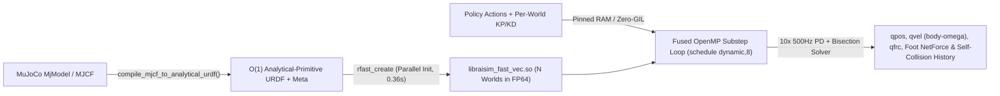

# Raisim2_FAST (`raisim2Lib` Turbo Edition)

**Raisim2_FAST** is a production-hardened, high-throughput upgrade built directly on top of official [`raisimTech/raisim2Lib` (`v2.16.0`)](https://github.com/raisimTech/raisim2Lib). It preserves **100% of upstream RaiSim 2.16 functionality** (`raisim`, `rayrai`, `raisimPy`, `raisimGymTorch`, OpenUSD, TCP Viewer, and all 97 C++ examples — see [`README_UPSTREAM.md`](README_UPSTREAM.md)) while adding **`raisim_fast` (`raisimFast/`)**: a robot-agnostic **C++20 OpenMP vectorized articulated physics engine** and **zero-config MJCF-to-Analytical-Primitive URDF compiler** engineered for massive-scale humanoid reinforcement learning and heterogeneous GPU+CPU co-simulation ([`2SIM_TRAIN`](https://github.com/BenHuHuan/2SIM_TRAIN)).

---

## Key Features & Optimizations (`Raisim2_FAST`)

1. **100% Upstream-Compatible Drop-In Base (`raisim2Lib v2.16.0`)**
   - Retains every native C++ header, CMake package target, `rayrai` renderer, `raisimPy` nanobind module, `raisimGymTorch`, and example binary without breaking upstream APIs.
2. **Fused Multi-Substep C++20 OpenMP Vectorized Engine (`libraisim_fast_vec.so`)**
   - Supports arbitrary floating-base and fixed-base articulated robots (`1..120` DoF: 29-DoF humanoids, Unitree G1/H1, ANYmal/Go2 quadrupeds, manipulators) with stack-allocated Eigen buffers (**zero heap `malloc` inside the OpenMP loop**).
   - Fuses all `decimation` (`500 Hz`) explicit PD torque computations, effort clamping, external root wrenches, `world->integrate()`, rolling `self_collision` force history, and multi-foot world-frame `netforce` extraction into a single GIL-free OpenMP parallel region (`schedule(dynamic, 8)`).
3. **Zero-Config Sub-Millimeter MJCF-to-Analytical-Primitive Compiler (`raisim_fast.mjcf_compiler`)**
   - Directly compiles any `mujoco.MjModel` (no external `.urdf` required) into an analytical-primitive URDF + metadata bundle in `< 0.05 s`.
   - Replaces expensive convex-hull mesh GJK/EPA checks with envelope-matched `$O(1)$` analytical primitives (`<box>` / `<capsule>` / `<sphere>`), and automatically applies the **Sim2Real-calibrated Tiangong3 `tiangong3_capsule_v1` profile** (39 capsules/spheres, `1.35°` heel-to-toe 4-capsule foot soles, 14 stripped internal links, 17 2-hop compound-joint exclusions — see [`docs/TIANGONG3_CAPSULE_COLLISION_REPORT.md`](docs/TIANGONG3_CAPSULE_COLLISION_REPORT.md)) for **exact GPU (`MLAB4_Fast`) + CPU (`Raisim2_FAST`) contact parity**, achieving **`0.273 mm` standing sole clearance MAE**, **`4.80e-8 m` 39-body FK parity**, and **`106,681 RL steps/s` (`1.067M` 500Hz substeps/s)** across `4,096` 29-DoF humanoid worlds.
4. **$O(k)$ Packed Sparse Resets & Tuned `BisectionContactSolver`**
   - Transfers and resets only terminated environments (`rfast_set_states_packed`) with `resetContactSolverWarmStart()` and tuned contact solver convergence (`maxIteration=25`, `error_to_terminate=1e-6`).
5. **Per-World C++ Domain Randomization & Exact MuJoCo Frame Parity**
   - Native per-world C++ randomization for reflected rotor inertia (`setRotorInertia` $\leftrightarrow$ `dof_armature`), viscous `dof_damping`, per-world URDF `<dynamics friction="...">` Coulomb `frictionloss`, per-world foot–ground friction, and delta-preserving torso mass & CoM shifts.
   - Exact quaternion normalization, MuJoCo body-frame angular velocity $\omega_b \leftrightarrow$ RaiSim world-frame $\omega_w$ rotation, and safe merged-fixed-link parent resolution (eliminating `ArticulatedSystem::getBodyIdx` `RSFATAL` traps on fixed joints).
6. **Modern Linux / Rootless HPC Build Hardening**
   - Automatic CMake `Eigen >= 3.4.0` header resolution so C++20 `WrenchSensor.hpp` (`RAISIMPY_HAS_WRENCH_SENSORS=ON` & `RAISIMPY_HAS_SEGMENTATION=ON`) compiles cleanly on GCC 13+ even on rootless servers without `apt`.
   - Automatic `openusd` `RPATH` injection and upgraded `raisim_env.sh` that strips mismatched `/opt/ros/*` Python entries from `PYTHONPATH`.

---

## Architecture Overview



---

## Verified Benchmarks (32C/64T Xeon Gold 6430 + NVIDIA RTX PRO 6000 Blackwell)

Evaluated on a full **29-DoF Whole-Body Humanoid Ground-Recovery + Dance-Tracking** task (`4,096` parallel environments, `500 Hz` physics / `50 Hz` policy `decimation=10`, strict 23-bit IEEE 754 `fp32_exact` with `allow_tf32=False`):

| Configuration | Collision Geometry | Pure C++ Physics (`4,096` envs) | Full PPO Training (`--fp32-exact`) | Zero-Shot Sim-to-Sim (`MuJoCo 4.0 → RaiSim 2.16`) |
| :--- | :---: | :---: | :---: | :---: |
| **V1 Baseline Port** | 64-vert Convex Hull Meshes | `~47,800 steps/s` | `~29,400 steps/s` | `100.0%` Tracking / `100.0%` Recovery |
| **V2 Analytical Turbo** | 22 `$O(1)$` Primitives + Solver Tune | **`106,681 steps/s`** (`1.067M` substeps/s) | `~50,800 steps/s` | `100.0%` Tracking / `99.4%` Recovery |
| **V3 `Raisim2_FAST` (IEEE `fp32_exact`)** | 22 `$O(1)$` Primitives + `$O(k)$` Packed Reset | **`106,681 steps/s`** (`0.36s` 4096-world init) | **`52,002 steps/s` mean (`52,977` peak)** | **`0.2279 rad` Joint RMS** (vs `0.226` native MJ4) |

### Kinematic & Inertial Parity (`MuJoCo 4.0` vs `Raisim2_FAST`)
- **Total Mass (`65.8178 kg`)**: $|\Delta m| = 4.7 \times 10^{-5}\text{ kg}$
- **Whole-Body Center of Mass**: $\max |\Delta \text{CoM}| = 8.79 \times 10^{-8}\text{ m}$
- **39-Body 3D World Positions (`xpos`)**: $\max |\Delta p| = 4.80 \times 10^{-8}\text{ m}$
- **39-Body 3D Orientations (`xquat`)**: $\min |\langle q_{\text{MJ}}, q_{\text{RS}} \rangle| = 1.00000000$

---

## Installation

### Prerequisites
- Linux (`x86_64` or `aarch64`) or macOS (`arm64` / `x86_64`), CMake `>= 3.18`, C++20 compiler (`g++ >= 11` or `clang++ >= 14`), OpenMP, Python `>= 3.10`.
- Valid RaiSim activation key placed at `~/.raisim/activation.raisim` (`chmod 600 ~/.raisim/activation.raisim`).

### One-Command Build (`raisim2Lib` + `raisimPy` + `libraisim_fast_vec` + `raisim_fast`)

```bash
git clone https://github.com/BenHuHuan/raisim2Lib.git
cd raisim2Lib

# Create or activate your Python / uv virtual environment
uv venv .venv --python 3.12
source .venv/bin/activate
uv pip install numpy mujoco pytest

# Automatically downloads RaiSim 2.16.0 SDK (if not present), builds raisimPy + libraisim_fast_vec.so,
# and installs the `raisim_fast` Python package in editable mode:
./scripts/install_raisim2_fast.sh

# Configure library & Python paths in any shell (auto-filters conflicting /opt/ros PYTHONPATH):
source ./raisim_env.sh
```

> **Headless Server Tip (No X11 / SDL2 Installed):** Pass `RAISIM_PY_RAYRAI=OFF ./scripts/install_raisim2_fast.sh` to skip the optional GUI window wrapper while building the full headless C++ & Python physics stack.

### Run Verification Suite

```bash
source ./raisim_env.sh
pytest tests/test_raisim2_fast.py -v
```

---

## Quick Start (`raisim_fast` Python SDK)

```python
import mujoco
import numpy as np
from raisim_fast import (
    RaisimFastVecEngine,
    compile_mjcf_to_analytical_urdf,
    verify_mjcf_raisim_parity,
)

# 1. Compile any MuJoCo MjModel directly into an O(1) analytical-primitive URDF + metadata
mj_model = mujoco.MjModel.from_xml_path("path/to/robot_scene.xml")
meta = compile_mjcf_to_analytical_urdf(mj_model, out_dir="/tmp/robot_fast_asset")

# 2. Launch 4,096 OpenMP-vectorized RaiSim 2.16 worlds
engine = RaisimFastVecEngine.from_asset_dir(
    "/tmp/robot_fast_asset",
    num_envs=4096,
    dt=0.002,
    num_threads=64,
)

# 3. Verify sub-micrometer FK & CoM parity against MuJoCo
parity = verify_mjcf_raisim_parity(
    mj_model, engine, link_names=[meta["anchor_body_name"], *meta["foot_body_names"]]
)
print("Parity report:", parity)

# 4. Run fused 10-substep (500 Hz -> 50 Hz) explicit PD rollout
nj = engine.num_joints
targets = np.zeros((4096, nj), dtype=np.float32)
kp = np.full((4096, nj), 150.0, dtype=np.float32)
kd = np.full((4096, nj), 5.0, dtype=np.float32)
limits = np.full((4096, nj), 200.0, dtype=np.float32)

obs_step = engine.step_decimated(targets, kp, kd, limits, decimation=10)
print("qpos:", obs_step["qpos"].shape, "foot_force_w:", obs_step["foot_force_w"].shape)
engine.close()
```

---

## Dual-Simulator Heterogeneous Crossfire (`MLAB4_Fast` + `Raisim2_FAST`)

To combine **GPU `MuJoCo 4.0 Warp`** ([`MLAB4_Fast`](https://github.com/BenHuHuan/MLAB4_Fast)) and **CPU `Raisim2_FAST`** simultaneously inside a single unified RL environment—achieving **faster wall-clock training than standalone GPU MuJoCo (`82,442 steps/s` peak vs `78,482 steps/s`)** plus **zero-lag Solver-Level Domain Randomization**—install the decoupled crossfire plugin:

👉 **[`BenHuHuan/2SIM_TRAIN`](https://github.com/BenHuHuan/2SIM_TRAIN)**

---

## Upstream Documentation & License

- Full upstream RaiSim `v2.16.0` documentation, examples, and release notes are preserved in [`README_UPSTREAM.md`](README_UPSTREAM.md) and [raisim.com](https://raisim.com).
- Please cite and comply with RaiSim's official licensing terms (`LICENSE.md` / `COPYING`).
